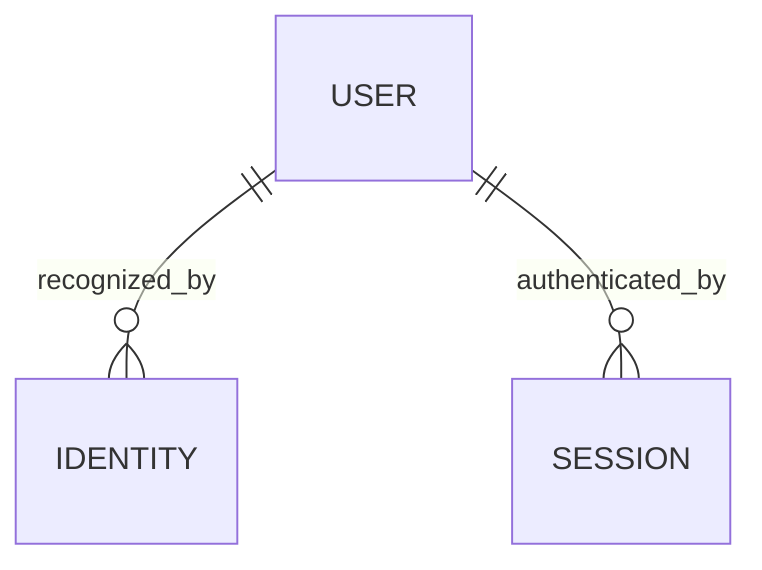
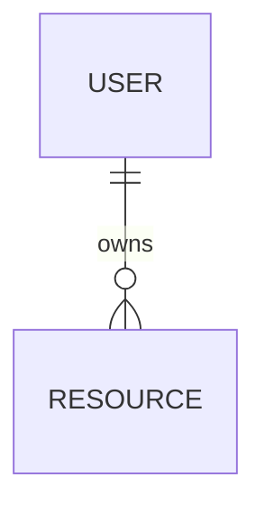
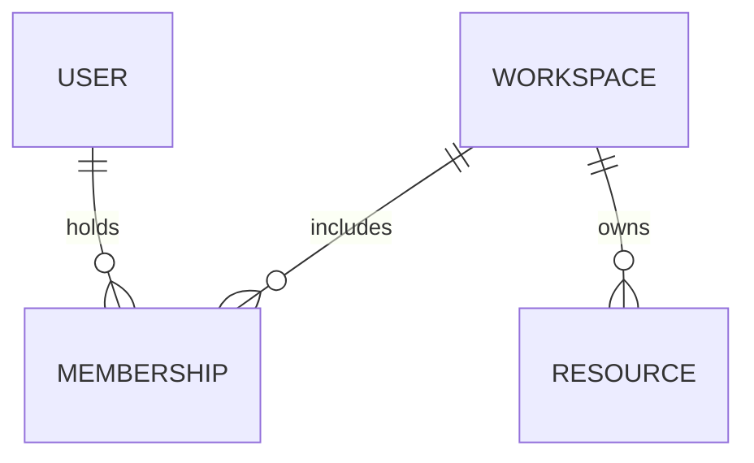
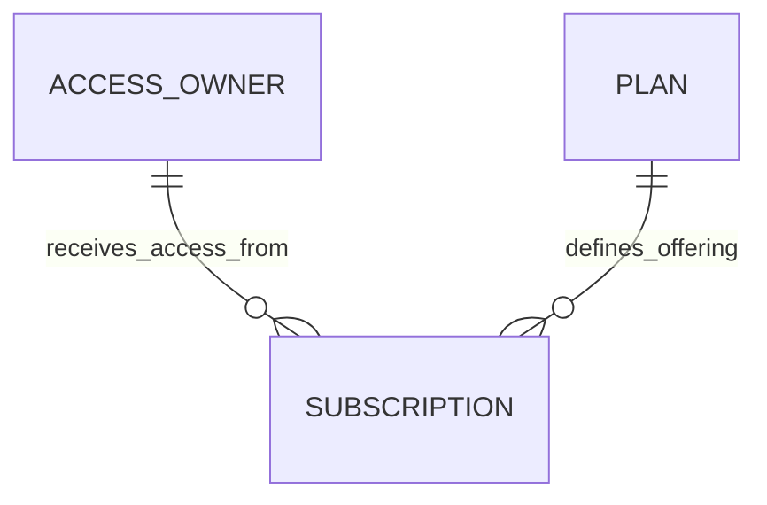
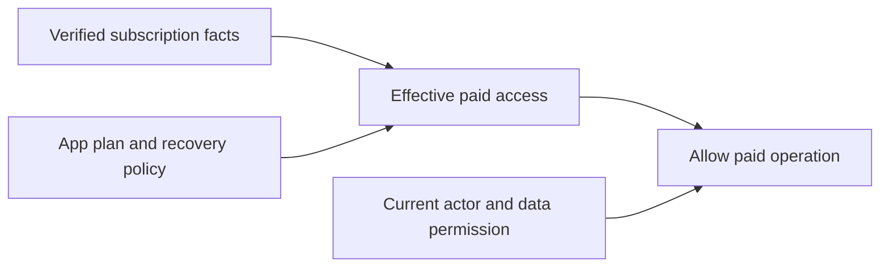
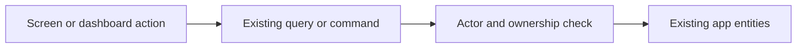

# Logical models for review

Boxes describe concepts, not required tables. Relationship labels state the meaning. These are separate choices/views; do not combine all boxes into a universal schema. Each linked spec defines minimum workflow information, its authority and conditional recovery values. Fields stay there so these diagrams cannot be mistaken for physical schema templates.

## Identity

Every accepted identity/session belongs to one user. A legacy user can exist before a provider identity is linked. Multiple identities are optional. The provider's existing user record may already supply the identity relationship; sessions normally remain provider-managed. **Zero new tables can be sufficient.** [Contract](specs/identity.md).

## Ownership

**Private personal data — start here when users do not share work.**

Each protected resource has one owner, directly or through its existing parent. RESOURCE means an existing app entity, such as a project or note; it is not a generic resource table. Public data is handled explicitly outside this private slice.

**Shared teams — use only when the app needs them.**

Each membership is one user/workspace pair. Use an existing team, account or project as WORKSPACE if it is the sharing boundary. The diagram permits an empty workspace structurally; an active workspace that requires an administrator must preserve that business rule in its mutation workflow. **Sharing adds at most two logical concepts to the personal model**, often already present. [Contract](specs/ownership.md).

## Subscriptions

ACCESS_OWNER is the existing USER **or** WORKSPACE selected by the product; it is not an additional entity. One owner may have past subscriptions; this slice allows at most one current grant. The app owner is the merchant. The provider customer reference identifies the payer, who may be different from the access owner. If the host already models payers, reuse it; don't add a payer table just for this graph.

PLAN can be configuration. SUBSCRIPTION is provider-owned; the host keeps a reference or only the facts its access decisions need. Capability policy plus verified subscription facts produces effective access, including a cutoff where applicable. **No separate entitlement table is required.** [Contract and field guidance](specs/subscriptions.md).

Both paid access and native data permission are required. The two inputs must be checked at the actual enforcing boundary; this diagram is not a replacement for that check.

## Management

This is an operation-mapping diagram, **not an additional LDM**.

Map fields, pagination, scoped totals and allowed actions to native operations. Where the operation is paid, also apply the subscription policy. **Zero new domain entities.** [Contract](specs/management.md).

## Simplicity decisions

| Concept | Default disposition |
| --- | --- |
| User and resource | Reuse existing IDs/entities |
| Identity and session | Reuse managed auth; map only when local identity differs |
| Workspace and membership | Omit for personal data; reuse existing sharing model otherwise |
| Access owner | A label for existing user/workspace, not new storage |
| Subscription | Provider-owned; keep minimal host mapping/projection |
| Plan and entitlement | Configuration and derived access unless host needs persistence |
| Screen resources/actions | Adapt existing operations, no second database |

No universal owner hierarchy, event bus, trigger framework, payment ledger or generalized role engine is implied. A concrete host can still need an extra record to preserve a real relationship; it must earn that addition in its bridge plan.
