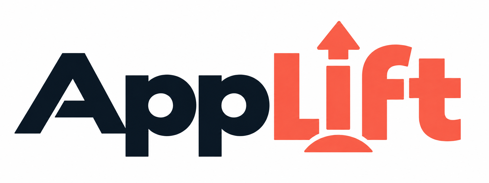

# AppLift

**LLM-first integration specs for adding authentication, multi-user access, subscriptions and admin dashboards to existing apps.**

**Keep your existing app and chosen providers.** AppLift supplies short design contracts for connecting authentication, customer ownership, subscriptions and background work to the entities and workflows you already have. Read only the relevant spec; no package installation or runtime dependency is required.

For example, Stripe explains how to create a subscription. AppLift helps map that subscription to the existing customer, decide which operations require paid access, and preserve correct behavior during cancellation, retries and membership changes. Use it alongside your provider's official documentation.

Draft 0.2. No runtime, required database, or generated code. Read the specs directly or load the instruction-only [agent skill](SKILL.md). Reuse the app's IDs, models, providers and authorization mechanisms. These are logical contracts, not a mandatory physical schema.

## When to choose AppLift

Choose it when provider instructions explain the API but leave the host design unresolved: which user owns existing records, who receives paid access, where a protected operation is authorized, or what happens after session expiry or payment failure. AppLift connects those decisions across the app and provider.

Skip solved sections. For a straightforward SDK call with no missing app relationship or workflow, the provider's own short recipe may be enough. AppLift earns its place only if reading and adapting the selected spec saves design work.

## Pick the requested transition

| User outcome | Read |
| --- | --- |
| Add Google/provider sign-in and session recovery | [Identity and session recovery](specs/identity.md) |
| Add private users or shared teams / multi-tenant ownership | [Ownership and sharing](specs/ownership.md) |
| Let each customer connect their own mailbox or service | [Connections and reconnection](specs/connections.md) |
| Keep imports, workers and search private; preserve completed work on replay | [Background work and business progress](specs/background-work.md) |
| Charge subscriptions and enforce paid features | [Subscriptions and access](specs/subscriptions.md) |
| Connect an admin template or dashboard to the database | [Management mapping](specs/management.md) |

Load only the relevant specification. Identity may already be solved. Personal data does not need workspaces. A dashboard does not need a second data model.

## Use it

1. Follow the existing app's instructions. Read [SKILL.md](SKILL.md) for the consumer workflow; AppLift's contributor rules do not override the host.
2. Inspect the host's existing entities, auth, access checks and operations. Map the requested outcome using the selected spec.
3. Keep a short [bridge plan](BRIDGE-PLAN.md): observed/proposed/unresolved mappings, affected operations and observable checks. See the [global personal-mailbox example](examples/personal-mailbox-app.md), or the [already-structured notes example](examples/paid-personal-app.md).
4. If implementation is requested, continue through the authorized change and checks. Use official provider documentation for SDK mechanics and configuration. Ask founders business questions; do not require them to design credential boundaries, ownership propagation or replay safety.

Each spec includes the minimum information its workflows need: meaning, authority, when needed and what it enables. Field names are illustrative. **Resolve each value from existing data, provider state or derivation before adding storage.** Add a field only when a selected workflow needs information that is otherwise unavailable; explain that gap in the bridge plan. Never copy every listed field into a migration.

The expected output is a host-specific plan naming existing fields/paths to reuse, the genuinely missing associations, affected queries/commands/screens, recovery behavior and essential checks. For example, if a note's owner is already available through its project, preserve that path instead of adding another owner column or a team model.

Example task: "Use AppLift's relevant specs to plan Google sign-in and recurring paid access for this existing app. Inspect the host first, preserve IDs and native guards, map only missing information, and identify operator decisions. Produce a bridge plan before implementation."

Use with a coding agent that can read Markdown and inspect the host source. Relational and document databases are both valid mapping targets; adapt the contracts to their actual enforcing mechanisms. One [independent implementation attempt](evidence/private-customer-trial.md) passed for a representative SQLite backend with simulated providers and no maintainer engineering correction. This is bounded evidence, not provider certification or measured adoption savings.

## Load as a skill

The repository root is a self-contained `applift-specs` skill package. For a supporting agent, copy `SKILL.md`, `BRIDGE-PLAN.md`, `MODELS.md`, `LICENSE`, `specs/` and `examples/` together into the host's supported skill location. One project-local path is `.agents/skills/applift-specs/`; keep the directory name aligned with the skill name. Do not copy this repository's `.git` directory or replace the host's `AGENTS.md`.

Explicitly request `$applift-specs` or ask the agent to use the skill at its installed path. Automatic matching depends on the host making the skill available and the task fitting its description; it is not guaranteed by publication. Consult the chosen agent's current setup guide. Direct reading remains valid without installation.

Review the [LDM diagrams](MODELS.md), [scope and validation status](STATUS.md), and [project background](HISTORY.md) separately. Full workflow engines, marketplace billing and additional provider wrappers remain outside this kit.

## Reuse and contribute

[MIT licensed](LICENSE). Copy and adapt the specs or include them in an agent's context; no AppLift runtime or attribution screen is required. Keep the license notice with substantial copies. Improvements should remove a concrete mapping ambiguity or unnecessary host change. Include the user outcome and smallest example; avoid provider-wrapper code and speculative framework support.

Contributors changing this repository must read [AGENTS.md](AGENTS.md). Consumers should retain their own host instructions and use only the relevant contracts.
